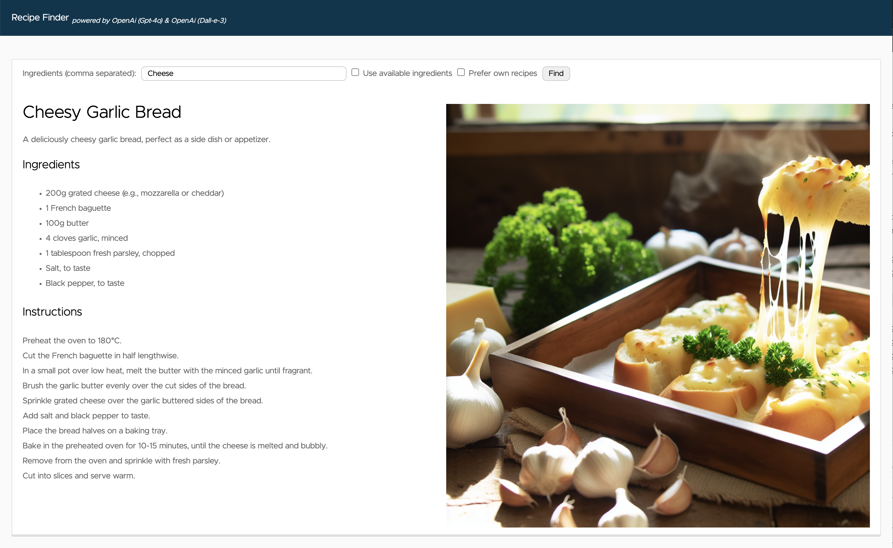
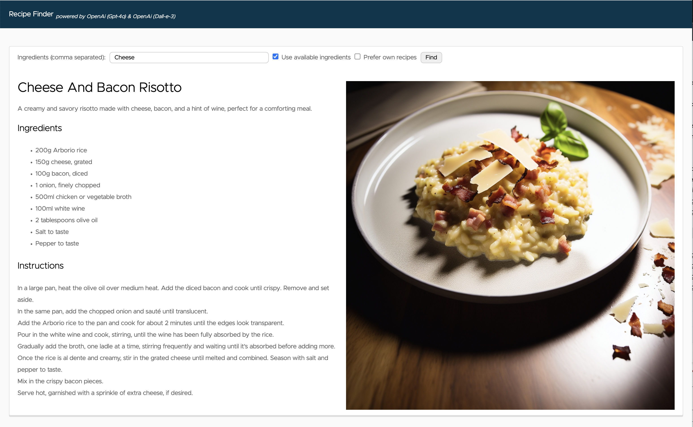
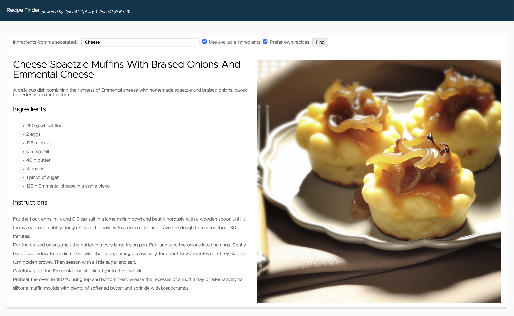

# Spring AI Recipe Finder

Demo on how easy it is to build AI-driven applications with Spring Boot and Spring AI. 
It also shows how to implement advanced techniques for the adaption of foundation models with Function Calling and RAG.

***Note: A Spring AI Recipe Finder implementation using the Model Context Protocol is available [here](https://github.com/timosalm/spring-ai-recipe-finder-mcp).***



[Slides: Building AI-Driven Spring Applications with Spring AI](docs/slides.pdf)

# Setup
## LLM
### OpenAI
Set the API key via an environment variable or in [application.yaml](src/main/resources/application.yaml).
```
export OPENAI_API_KEY=<INSERT KEY HERE>
```

### Azure OpenAI
Set the API key and endpoint via environment variables or in [application-azure.yaml](src/main/resources/application-azure.yaml).
```
export AZURE_OPENAI_API_KEY=<INSERT KEY HERE>
export AZURE_OPENAI_BASE_URL=https://{your-resource-name}.openai.azure.com
```

Currently, [**only some regions support image generation**](https://learn.microsoft.com/en-us/azure/ai-services/openai/concepts/models).
If you use a region that doesn't support it, you have to disable the image generation by setting `spring.ai.model.image: none` in the [application-azure.yaml](src/main/resources/application-azure.yaml) configuration file to not run into errors.

Run your application with the "azure" Spring Profile.
```
export SPRING_PROFILES_ACTIVE=azure
```

### Vector DB
On your local machine, a Redis database is automatically started and configured with docker compose. As a fallback if no Redis database is configured, a SimpleVectorStore instance will be used.

# Running the application locally
```
./gradlew bootRun
```
Open [http://localhost:8080](http://localhost:8080) in your browser. 
Enter the ingredients (e.g. "Cheese") you want to find a recipe for in the form and press the "find" button.

## Tool Calling 
By checking the "Prefer available ingredients" checkbox, [Tool Calling](https://docs.spring.io/spring-ai/reference/api/tools.html) will be enabled.
As the functionality for the API call to check the available ingredients in the fridge is mocked, they can be configured via the
`app.available-ingredients-in-fridge` property in [application.yaml](src/main/resources/application.yaml).

Bacon and onions are currently configured for available ingredients in fridge.
With the input "Cheese", you should get a recipe with cheese and bacon.


## Retrieval-Augmented Generation(RAG)
By checking the "Prefer own recipes" checkbox, [Retrieval-Augmented Generation](https://docs.spring.io/spring-ai/reference/concepts.html#concept-rag) will be enabled.

To upload your own PDF documents for recipes to the vector database, there is a REST API endpoint implemented. 
```
curl -XPOST -F "file=@$PWD/german_recipes.pdf" -F "pageBottomMargin=50" http://localhost:8080/api/v1/recipes/upload
```
Based on the sample recipes part of this repository, with the input "Cheese", you should get a recipe that goes in the direction of a cheese spaetzle muffin.
